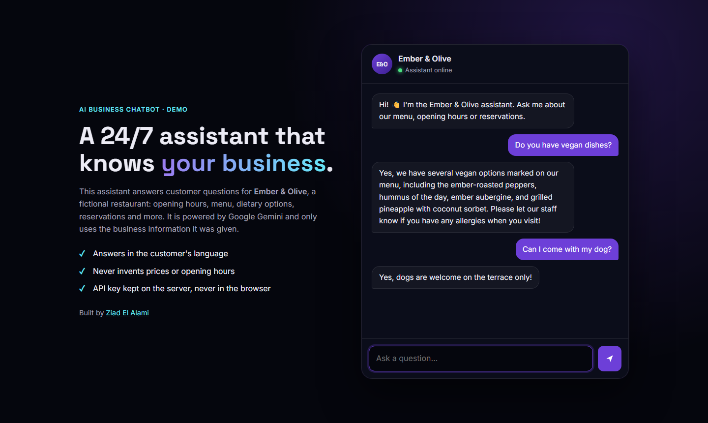

# AI Business Chatbot (Gemini)

[](https://github.com/elalamiz605-tech/ai-business-chatbot/actions/workflows/ci.yml)


A customer-support chatbot for small businesses, powered by **Google Gemini**.
It answers customer questions (opening hours, menu, prices, reservations, policies) **only from the business's own information**, in the customer's language, 24/7.

This demo is set up for **Ember & Olive**, a *fictional* Mediterranean restaurant (see the [restaurant website demo](https://elalamiz605-tech.github.io/restaurant-website-demo/)).



## What it does

- 💬 **Answers customer FAQs** using the facts in [`data/business.json`](data/business.json)
- 🌍 **Replies in the customer's language** (English, Spanish, French…)
- 🛑 **Doesn't make things up**: if the answer isn't in the data, it says so and gives the phone/email
- 🔒 **Keeps the API key secret**: the browser talks to our Flask server, and only the server calls Gemini
- 🧪 **Demo mode**: runs without an API key using simple keyword answers, so anyone can try it
- 🔗 **Deep links**: `/?q=Do you have vegan dishes?` opens the chat and asks the question right away

## How it works

```
Browser (static/)  ──POST /api/chat──▶  Flask server (app.py)  ──HTTPS + API key──▶  Gemini API
   chat UI                               • validates input                            
   no API key                            • rate-limits (20 msg/min/IP)                 
                                         • adds business knowledge as system prompt    
```

| File | Role |
| --- | --- |
| `app.py` | Flask server: serves the page, validates requests, rate limiting, calls Gemini |
| `chatbot/knowledge.py` | Loads `business.json`, builds the system prompt, demo-mode answers |
| `chatbot/gemini.py` | Small Gemini REST client (server-side only) |
| `data/business.json` | **Edit this** to adapt the bot to any business |
| `static/` | Chat interface (HTML, CSS, vanilla JS) |
| `tests/` | Automated tests (pytest), run on every push by GitHub Actions |

## Installation

Requirements: **Python 3.10+** and a free Gemini API key from [Google AI Studio](https://aistudio.google.com/apikey).

```bash
git clone https://github.com/elalamiz605-tech/ai-business-chatbot.git
cd ai-business-chatbot

python -m venv .venv
# Windows:  .venv\Scripts\activate
# macOS/Linux:  source .venv/bin/activate
pip install -r requirements.txt

cp .env.example .env        # Windows: copy .env.example .env
# then open .env and paste your key:  GEMINI_API_KEY=...

python app.py
```

Open **http://127.0.0.1:5000** and start chatting.
No key? Leave `GEMINI_API_KEY` empty and the bot starts in **demo mode**.

## Configuration (`.env`)

| Variable | Default | Description |
| --- | --- | --- |
| `GEMINI_API_KEY` | *(empty → demo mode)* | Your Gemini API key. **Never commit it.** |
| `GEMINI_MODEL` | `gemini-3.5-flash-lite` | Any Gemini model that supports `generateContent` |
| `PORT` | `5000` | Local server port |

## Security

- `.env` is listed in `.gitignore`: the real key never goes to GitHub. Only `.env.example` (with a placeholder) is committed.
- The key is sent to Google in a request header from the server; it never appears in the page or in API responses.
- User messages are length-limited, the conversation history is validated, and requests are rate-limited.
- Bot replies are inserted with `textContent` (no HTML injection).
- Flask's debugger is disabled.

> For production, run behind a WSGI server (e.g. `waitress` or `gunicorn`) and HTTPS, and use a shared rate limiter if you run several instances.

## Tests

32 automated tests cover request validation, rate limiting, demo mode, the system prompt and the Gemini client (with the network mocked, so no API key is needed). They run on every push with GitHub Actions on Python 3.10 and 3.13.

```bash
pip install -r requirements-dev.txt
python -m pytest
```

## Adapting it to another business

1. Replace the content of `data/business.json` (name, hours, products/services, policies).
2. Update the texts and suggestions in `static/index.html`.
3. Restart the server. That's it.

## Tech stack

Python · Flask · Google Gemini API · pytest · GitHub Actions · HTML · CSS · JavaScript

---

Built by **[Ziad El Alami](https://elalamiz605-tech.github.io)**. Want an AI assistant for your business? [Let's talk](mailto:elalamiz605@gmail.com).
